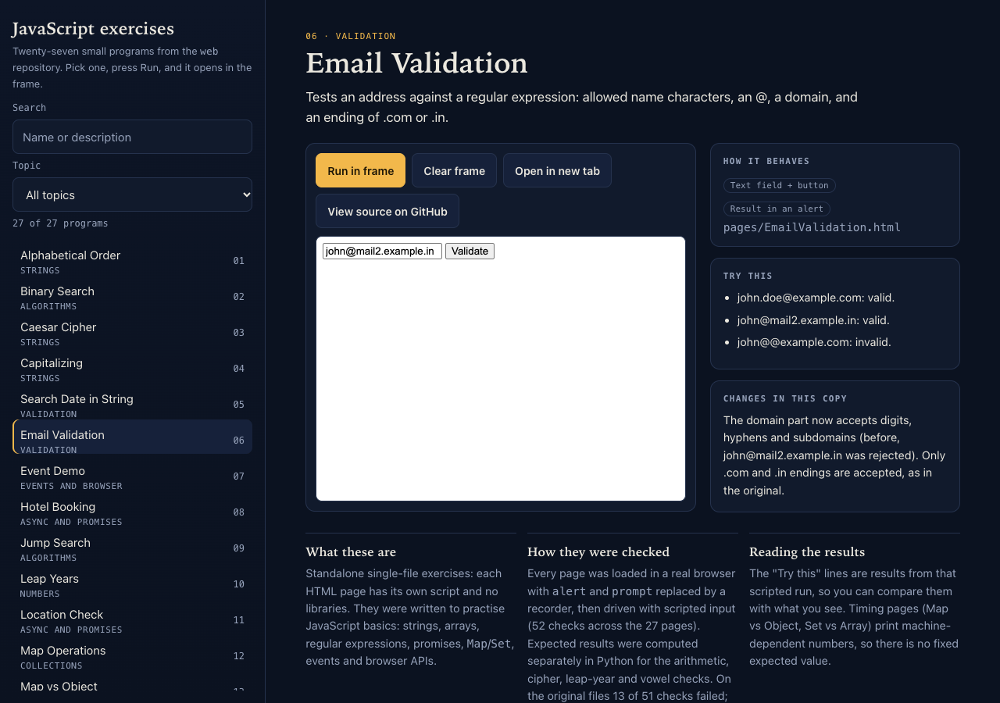
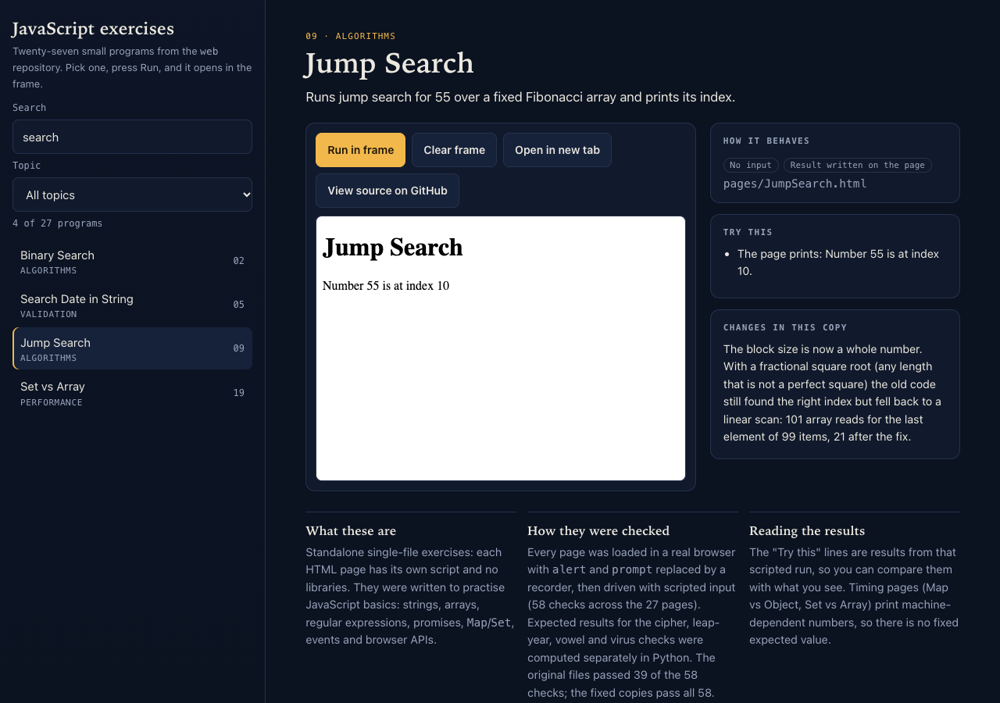

# web: 27 small JavaScript exercises

Twenty-seven standalone HTML pages, each a short JavaScript exercise: searching and sorting, a Caesar cipher, regular-expression validation, promises and timers, `Map` and `Set`, events, localStorage and geolocation. Every page is a single file with its own `<script>`; there are no libraries and no build step.

This README, the fixes below and a browsable gallery in `docs/` were added later. The gallery lists all 27 pages with a one-line description each and runs any of them in a frame.





## Open the gallery

- Locally: open `docs/index.html` in a browser. The frame cannot show `alert`/`prompt` dialogs from a local file in some browsers; "Open in new tab" always works.
- On GitHub Pages: not enabled. If you turn it on (Settings, Pages, deploy from branch `main`, folder `/docs`), the gallery is the site's front page and the frame works with dialogs.
- Any single exercise: open its `.html` file from the repo root in a browser.

## The 27 pages

| # | Page | Topic | What it does | Change in this version |
|---|---|---|---|---|
| 1 | [`AlphabeticalOrder.html`](https://github.com/AaronMackenzie/web/blob/main/AlphabeticalOrder.html) | Strings | Sorts the characters of a typed string into code-point order, so spaces and capitals come before lowercase letters. | unchanged |
| 2 | [`BinarySearch.html`](https://github.com/AaronMackenzie/web/blob/main/BinarySearch.html) | Algorithms | Asks for a comma-separated list and a target, sorts the list, runs binary search and reports the index or that it was not found. | Numbers are compared as numbers and spaces are trimmed (before, the list was compared as text, so 5 was never found in 1, 5, 10, 20, 30). The list is sorted first, since binary search needs that. Cancel no longer throws an error. |
| 3 | [`CaesarCipher.html`](https://github.com/AaronMackenzie/web/blob/main/CaesarCipher.html) | Strings | Encrypts text with a Caesar shift (a positive integer, wrapping past z and Z) and leaves non-letters unchanged. | Cancel on the text prompt no longer throws an error. |
| 4 | [`Capitalizing.html`](https://github.com/AaronMackenzie/web/blob/main/Capitalizing.html) | Strings | Upper-cases the first letter of every word and lower-cases the rest. | Cancel no longer throws an error. |
| 5 | [`Date.html`](https://github.com/AaronMackenzie/web/blob/main/Date.html) | Validation | Finds a date written as mm/dd/yyyy inside a sentence using a regular expression. | Only real calendar dates are accepted (before, 99/99/9999 counted as a date), and later matches in the sentence are checked if the first is not valid. |
| 6 | [`EmailValidation.html`](https://github.com/AaronMackenzie/web/blob/main/EmailValidation.html) | Validation | Tests an address against a regular expression: allowed name characters, an @, a domain, and an ending of .com or .in. | The domain part now accepts digits, hyphens and subdomains (before, john@mail2.example.in was rejected). Only .com and .in endings are accepted, as in the original. |
| 7 | [`EventDemo.html`](https://github.com/AaronMackenzie/web/blob/main/EventDemo.html) | Events and browser | Five controls that each raise an alert from a different event: click, mouseover, mouseout, change on a text box, and keydown with the key code. | unchanged |
| 8 | [`HotelBooking.html`](https://github.com/AaronMackenzie/web/blob/main/HotelBooking.html) | Async and promises | Chains two promises: asks for a flight number after 2 s, then a hotel name after another 2 s, then confirms the booking. | The 'Booking successfully' alert used to appear even when the hotel prompt was cancelled; it now only appears on success. |
| 9 | [`JumpSearch.html`](https://github.com/AaronMackenzie/web/blob/main/JumpSearch.html) | Algorithms | Runs jump search for 55 over a fixed Fibonacci array and prints its index. | The block size is now a whole number. With a fractional square root (any length that is not a perfect square) the old code still found the right index but fell back to a linear scan: 101 array reads for the last element of 99 items, 21 after the fix. |
| 10 | [`LeapYears.html`](https://github.com/AaronMackenzie/web/blob/main/LeapYears.html) | Numbers | Lists the leap years between two years: divisible by 4, except centuries that are not divisible by 400. | unchanged |
| 11 | [`LocationCheck.html`](https://github.com/AaronMackenzie/web/blob/main/LocationCheck.html) | Async and promises | A promise resolves with your sentence if it contains the place name (ignoring case) and rejects with a message if not. | Cancel no longer produces a TypeError message. |
| 12 | [`MapOperations.html`](https://github.com/AaronMackenzie/web/blob/main/MapOperations.html) | Collections | Stores key/value pairs in a Map (an empty entry stops), looks a key up, and lists all entries. | Pressing Cancel used to loop forever (Cancel returns null, which the loop never treated as the end); Cancel now stops the entry loop. |
| 13 | [`MapVsObject.html`](https://github.com/AaronMackenzie/web/blob/main/MapVsObject.html) | Performance | Times one million insertions into a Map and into a plain object and shows both times in milliseconds. | unchanged |
| 14 | [`MultipleCallback.html`](https://github.com/AaronMackenzie/web/blob/main/MultipleCallback.html) | Async and promises | Runs three timed promise callbacks one after the other (2 s, 1.5 s, 1 s), logging each, then prints 'All callbacks executed'. | unchanged |
| 15 | [`OddOrEven.html`](https://github.com/AaronMackenzie/web/blob/main/OddOrEven.html) | Numbers | Asks for a number and says whether it is odd or even. | Decimals used to be cut to a whole number (3.7 was reported as '3 is odd'); they are now rejected as invalid. |
| 16 | [`PromiseArithmetic.html`](https://github.com/AaronMackenzie/web/blob/main/PromiseArithmetic.html) | Async and promises | Takes two numbers and an operator and evaluates them inside a promise with a delay (1 s for +, 2 s for -, 3 s for *, 4 s for /); division by zero rejects. | Numbers are read as decimals (before, 2.5 + 2 gave 4) and invalid input is reported instead of printing NaN. |
| 17 | [`Reversal.html`](https://github.com/AaronMackenzie/web/blob/main/Reversal.html) | Numbers | Reverses the digits of a whole number. | The sign is kept (before, -123 gave 321) and non-numbers are reported instead of NaN. |
| 18 | [`SetOperations.html`](https://github.com/AaronMackenzie/web/blob/main/SetOperations.html) | Collections | Adds values to a Set until you type done, checks whether a value is in the Set, and lists the values (duplicates are kept once). | Pressing Cancel used to loop forever; it now ends the entry loop like typing done. |
| 19 | [`SetVsArray.html`](https://github.com/AaronMackenzie/web/blob/main/SetVsArray.html) | Performance | Times one million insertions into a Set and an array, then looks up one value in each to compare search time. | unchanged |
| 20 | [`String2Array.html`](https://github.com/AaronMackenzie/web/blob/main/String2Array.html) | Strings | Splits a sentence into an array of words. | Runs of spaces no longer produce empty entries. |
| 21 | [`Sum.html`](https://github.com/AaronMackenzie/web/blob/main/Sum.html) | Numbers | Adds two numbers, decimals allowed. | Non-numbers are reported instead of showing NaN. |
| 22 | [`Usn.html`](https://github.com/AaronMackenzie/web/blob/main/Usn.html) | Validation | Checks a university seat number in the VTU style: 1, two letters, two digits, two letters, three digits. | unchanged |
| 23 | [`VirusDetection.html`](https://github.com/AaronMackenzie/web/blob/main/VirusDetection.html) | Algorithms | Reports POSITIVE if every letter of the blood composition appears in order (not necessarily next to each other) in the virus composition, ignoring case; otherwise NEGATIVE. | unchanged |
| 24 | [`VisitorCount.html`](https://github.com/AaronMackenzie/web/blob/main/VisitorCount.html) | Events and browser | Keeps a counter in the browser's localStorage and adds one each time the page loads. | unchanged |
| 25 | [`VowelCount.html`](https://github.com/AaronMackenzie/web/blob/main/VowelCount.html) | Strings | Counts the vowels a, e, i, o, u in a string, in either case. | Cancel no longer throws an error. |
| 26 | [`WeightConversion.html`](https://github.com/AaronMackenzie/web/blob/main/WeightConversion.html) | Numbers | Converts kilograms to pounds (kg times 2.2) and prints a label: above 150 lb 'obese', 100 to 150 lb 'you are ok', below 'underweight'. The thresholds come from the exercise and are not medical advice. | Non-numbers and zero or negative weights are now rejected (before, 'abc' printed 'underweight'). |
| 27 | [`location.html`](https://github.com/AaronMackenzie/web/blob/main/location.html) | Events and browser | Asks the browser for your position and shows the latitude and longitude, or a message if permission is denied or unavailable. | unchanged |

## How the pages were tested

Each page was loaded in a real browser (Chrome driven over the DevTools protocol). `alert` and `prompt` were replaced by a recorder so scripted answers could be fed in and every message captured; geolocation was replaced by fixed coordinates, so a real device location was **not** tested. There are 58 checks over the 27 pages. Expected results for the cipher, leap-year, vowel-count and virus (subsequence) checks were computed separately in Python; the rest are written out by hand from reading each file.

| Version | Checks passed |
|---|---|
| Original files | 39 of 58 |
| Fixed copies (repo root and `docs/pages/`) | 58 of 58, no script errors on any page |

Two of the original failures are endless loops: pressing Cancel in `MapOperations.html` or `SetOperations.html` makes `prompt()` return `null`, which neither loop treats as the end. In the test the recorder stops them after 60 prompts; in a normal browser they keep asking.

I also compared the jump search before and after the fix over every array length from 1 to 60 and every target from -2 to 3n+3 (5,850 searches): both versions return the right index every time. The difference is cost: for the last element of a 99-item array the original read 101 array elements and the fixed version reads 21.

## Honest notes

- `VisitorCount.html` counts page loads in one browser (localStorage); it is not a real visitor counter.
- `WeightConversion.html` keeps the exercise's thresholds (over 150 lb "obese", 100 to 150 lb "you are ok", below "underweight"). They are not a medical classification.
- `EmailValidation.html` accepts only addresses ending in `.com` or `.in`, as in the original. It is a classroom pattern, not a general email validator.
- `EventDemo.html` still uses `event.keyCode`, which is deprecated but works in current browsers.
- The two timing pages (`MapVsObject`, `SetVsArray`) print machine-dependent numbers, so they have no fixed expected output.
- `location.html` needs permission and an https or localhost address; it does not work from some `file://` setups.
- Several pages use `alert` and `prompt`, as in the original exercises. I did not turn them into on-page forms.

## Fixes made

Seventeen pages changed; the other ten are untouched. Summary by cause:

- **Cancel handling**: `BinarySearch`, `CaesarCipher`, `Capitalizing`, `Date`, `LocationCheck`, `String2Array` and `VowelCount` threw a `TypeError` when Cancel was pressed; `MapOperations` and `SetOperations` looped forever.
- **Wrong results**: binary search compared numbers as text (5 was not found in `1, 5, 10, 20, 30`); `Date` accepted 99/99/9999; `EmailValidation` rejected digits and subdomains; `Reversal` dropped the minus sign; `PromiseArithmetic` and `OddOrEven` cut decimals to whole numbers; `String2Array` returned empty entries for repeated spaces; `HotelBooking` alerted "Booking successfully" after a failed booking.
- **Missing validation**: `Sum`, `WeightConversion` and `PromiseArithmetic` printed `NaN` or "underweight" for non-numbers.
- **Efficiency**: `JumpSearch` used a fractional block size and degraded to a linear scan.

The repo-root files and the copies in `docs/pages/` are identical. After editing a root page, refresh the copy with `cp *.html docs/pages/`.

## Repo layout

```
.
├── *.html                 the 27 exercises (fixed versions)
├── README.md
└── docs/
    ├── index.html         gallery (single file, no external requests)
    ├── pages/*.html       copies of the 27 exercises, so a /docs site can serve them
    └── assets/            README screenshots
```

## Requirements

A modern browser. No dependencies.
